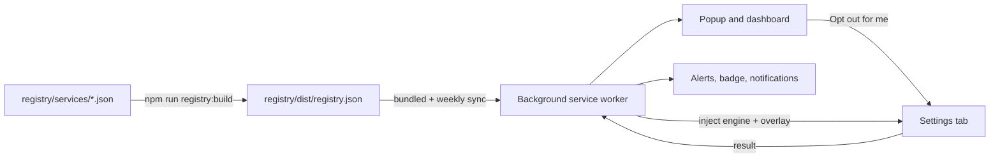

# NoTrain

**See which services train AI on your data, opt out in a click, and get told when that changes.**

NoTrain is a free, open-source browser extension (Chrome and Firefox). It works from an open,
community-maintained registry of online services. For each one it tells you in plain language whether
the service uses your data to train AI and what the default is, then helps you opt out:

- **One click, where possible.** NoTrain opens the right settings page and flips the switch for you
  while you watch, then checks that it stuck.
- **Guided, everywhere else.** Step-by-step instructions with a deep link and on-page highlighting.
- **Request letters.** Ready-to-send objection, erasure and access requests matched to your region
  (GDPR, UK GDPR, Swiss FADP, CCPA/CPRA, PIPEDA, LGPD and more).

Then it keeps watching:

- **Policy-change alerts.** The registry updates weekly. If a service you use starts training on your
  data or changes its opt-out, you get a notification.
- **Flip-back detection.** Settings sometimes get switched back on. When you visit a settings page
  NoTrain has access to, it quietly checks that your choice is still in place.
- **Re-check reminders** for settings that can't be checked automatically.

Also included: a **robots.txt / ai.txt / TDMRep generator** for website owners who want to block AI
training crawlers while staying visible in search, and a proposed open standard,
[`/.well-known/ai-training-opt-out`](spec/well-known-ai-training-opt-out.md), so services can publish
their opt-out in a machine-readable way.

## Privacy

NoTrain has no servers, no accounts and no analytics. Everything stays in your browser. The only network
request it makes by itself is downloading the public registry file from this repository. It asks for
access to a site only when you click "Opt out for me" on that service, and account detection is opt-in
and gives the extra permission back as soon as it's done. Full details: [PRIVACY.md](PRIVACY.md).

## Honest limitations

- Opting out usually only affects the future. Data already used to train a model generally stays in it.
- Sites change their settings pages. Automation is tested against mock copies of each page, not the live
  sites, and every recipe is labelled "Experimental" or "Usually works". When a page has changed,
  NoTrain falls back to guided steps.
- Some services have no opt-out at all, or only offer one in some regions. NoTrain says so rather than
  pretending otherwise.
- Request letters are templates, not legal advice.

## Supported services

<!-- services:start (generated by scripts/readme-services.mjs, do not edit) -->

34 services, 13 with one-click automation. "Default: On" means the service trains on your data unless you opt out.

| Service                                                                   | Company                                             | Trains on your data | Default          | Ways to opt out         | Automated          | Last verified |
| ------------------------------------------------------------------------- | --------------------------------------------------- | ------------------- | ---------------- | ----------------------- | ------------------ | ------------- |
| [Adobe](registry/services/adobe.json)                                     | Adobe Inc.                                          | Sometimes           | On               | Setting                 | Yes (experimental) | 2026-09-28    |
| [Amazon Alexa](registry/services/amazon-alexa.json)                       | Amazon.com, Inc.                                    | Yes                 | On               | Setting                 | No                 | 2026-09-28    |
| [Canva](registry/services/canva.json)                                     | Canva Pty Ltd                                       | Sometimes           | Off              | Setting                 | No                 | 2026-09-28    |
| [ChatGPT](registry/services/chatgpt.json)                                 | OpenAI                                              | Yes                 | On               | Setting, Web form       | Yes (medium)       | 2026-09-28    |
| [Claude](registry/services/claude.json)                                   | Anthropic                                           | Yes                 | On               | Setting, Request letter | Yes (medium)       | 2026-09-28    |
| [DeepSeek](registry/services/deepseek.json)                               | Hangzhou DeepSeek Artificial Intelligence Co., Ltd. | Yes                 | On               | Setting, Request letter | No                 | 2026-09-28    |
| [Dropbox](registry/services/dropbox.json)                                 | Dropbox, Inc.                                       | No                  | n/a              | None available          | No                 | 2026-09-28    |
| [Facebook](registry/services/facebook.json)                               | Meta Platforms                                      | Yes                 | Varies by region | Web form                | No                 | 2026-09-28    |
| [Figma](registry/services/figma.json)                                     | Figma, Inc.                                         | Sometimes           | On               | Setting                 | No                 | 2026-09-28    |
| [Gemini](registry/services/gemini.json)                                   | Google                                              | Yes                 | On               | Setting                 | Yes (experimental) | 2026-09-28    |
| [GitHub Copilot](registry/services/github.json)                           | GitHub (Microsoft)                                  | Yes                 | On               | Setting, Web form       | Yes (experimental) | 2026-09-28    |
| [Grammarly](registry/services/grammarly.json)                             | Superhuman Platform Inc. (formerly Grammarly)       | Yes                 | On               | Setting                 | Yes (medium)       | 2026-09-28    |
| [Grok](registry/services/grok.json)                                       | xAI                                                 | Yes                 | On               | Setting                 | No                 | 2026-09-28    |
| [Instagram](registry/services/instagram.json)                             | Meta Platforms                                      | Yes                 | Varies by region | Web form                | No                 | 2026-09-28    |
| [LinkedIn](registry/services/linkedin.json)                               | LinkedIn (Microsoft)                                | Yes                 | On               | Setting, Web form       | Yes (medium)       | 2026-09-28    |
| [Meta AI](registry/services/meta-ai.json)                                 | Meta Platforms                                      | Yes                 | Varies by region | Web form                | No                 | 2026-09-28    |
| [Microsoft Copilot](registry/services/microsoft-copilot.json)             | Microsoft                                           | Sometimes           | Varies by region | Setting                 | No                 | 2026-09-28    |
| [Mistral Vibe (formerly Le Chat)](registry/services/mistral-le-chat.json) | Mistral AI                                          | Yes                 | On               | Setting, Web form       | No                 | 2026-09-28    |
| [Notion](registry/services/notion.json)                                   | Notion Labs, Inc.                                   | No                  | Off              | None available          | No                 | 2026-09-28    |
| [Perplexity](registry/services/perplexity.json)                           | Perplexity AI                                       | Yes                 | On               | Setting, Web form       | Yes (medium)       | 2026-09-28    |
| [Pinterest](registry/services/pinterest.json)                             | Pinterest, Inc.                                     | Yes                 | On               | Setting                 | Yes (experimental) | 2026-09-28    |
| [Quora](registry/services/quora.json)                                     | Quora, Inc.                                         | Sometimes           | On               | Setting                 | Yes (medium)       | 2026-09-28    |
| [Reddit](registry/services/reddit.json)                                   | Reddit, Inc.                                        | Yes                 | No choice        | None available          | No                 | 2026-09-28    |
| [Slack](registry/services/slack.json)                                     | Slack Technologies (Salesforce)                     | Sometimes           | On               | Request letter          | No                 | 2026-09-28    |
| [Snapchat](registry/services/snapchat.json)                               | Snap Inc.                                           | Yes                 | On               | Setting                 | No                 | 2026-09-28    |
| [Stack Overflow](registry/services/stack-overflow.json)                   | Stack Overflow (Stack Exchange, Inc.)               | Yes                 | No choice        | None available          | No                 | 2026-09-28    |
| [Substack](registry/services/substack.json)                               | Substack Inc.                                       | Sometimes           | On               | Setting                 | No                 | 2026-09-28    |
| [Threads](registry/services/threads.json)                                 | Meta Platforms                                      | Yes                 | Varies by region | Web form                | No                 | 2026-09-28    |
| [TikTok](registry/services/tiktok.json)                                   | TikTok                                              | Yes                 | No choice        | Web form                | No                 | 2026-09-28    |
| [Tumblr](registry/services/tumblr.json)                                   | Automattic                                          | Yes                 | On               | Setting                 | Yes (experimental) | 2026-09-28    |
| [WordPress.com](registry/services/wordpress-com.json)                     | Automattic Inc.                                     | Sometimes           | On               | Setting                 | Yes (experimental) | 2026-09-28    |
| [X (Twitter)](registry/services/x.json)                                   | X Corp. (xAI)                                       | Yes                 | On               | Setting, Web form       | Yes (medium)       | 2026-09-28    |
| [YouTube](registry/services/youtube.json)                                 | Google                                              | Yes                 | No choice        | None available          | No                 | 2026-09-28    |
| [Zoom](registry/services/zoom.json)                                       | Zoom Communications, Inc.                           | No                  | n/a              | None available          | No                 | 2026-09-28    |

<!-- services:end -->

## Install

NoTrain is not in the Chrome Web Store or Firefox Add-ons yet. To run it from source:

```sh
npm ci
npm run build          # writes dist/chrome, dist/firefox and zip files
```

- **Chrome / Edge / Brave:** open `chrome://extensions`, turn on Developer mode, click _Load unpacked_
  and choose `dist/chrome` (or the `extension/` folder directly).
- **Firefox (128+):** open `about:debugging#/runtime/this-firefox`, click _Load Temporary Add-on_ and
  choose `dist/firefox/manifest.json`.

## How it works



- `registry/` holds one JSON file per service, validated against
  [`registry/schema/service.schema.json`](registry/schema/service.schema.json), with sources and a
  last-verified date.
- `extension/` is the MV3 extension: plain ES modules, no build step, no runtime dependencies.
  Automation recipes are data (a small declarative DSL) run by a bundled engine, so no remote code is
  ever executed.
- [ARCHITECTURE.md](ARCHITECTURE.md) documents the storage model, message contract, run flow and
  monitoring.

## Development

```sh
npm ci
npm run check          # lint, format check, registry validation, unit tests
npm run test:e2e       # Playwright end-to-end tests (headless Chromium with the extension loaded)
npm run registry:build # recompile the registry after editing registry/services/*.json
npm run policy-watch   # fetch watched policy pages and report changes
```

## Contributing

Corrections to the registry are the most valuable contribution: policies change constantly. See
[CONTRIBUTING.md](CONTRIBUTING.md). To report a wrong entry, use the "Report an error" link on any
service page in the extension, or open an issue.

## License

[MIT](LICENSE)
